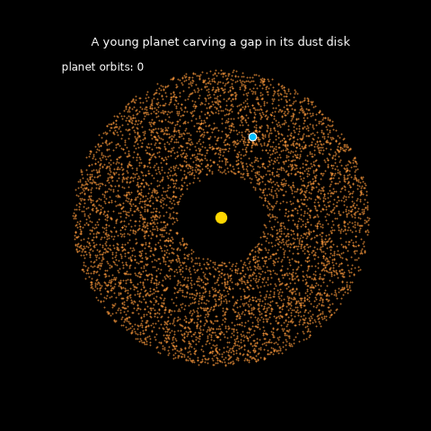
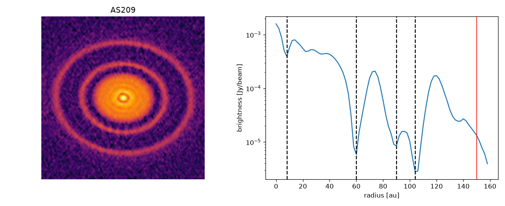

# Finding Planet-Forming Gaps in Young Star Disks

Young stars are surrounded by disks of gas and dust where planets form. High-resolution
ALMA images show that many of these disks have dark **gaps**, possibly cleared by young
planets as they orbit.

This project takes real ALMA images from the **DSHARP** survey, automatically detects the
gaps in 8 disks, checks them against the published results, and estimates what mass of
planet could have carved each one.



*A simple gravity simulation: 6,000 dust grains orbit a star while a planet of about
5 Jupiter masses clears a gap along its path.*

## How it works

1. **Load** the ALMA image (FITS file) of a disk.
2. **Undo the tilt**: each disk is tilted toward us, so the code converts every pixel to
   its true distance from the star using the disk's inclination and orientation.
3. **Build a radial profile**: average brightness in 2 au wide rings around the star.
4. **Detect gaps**: dips in the profile, at least ~12% deep, inside the disk's edge.
5. **Estimate planet mass**: from each gap's width, using the Kanagawa et al. (2016)
   gap-width relation.



## Results

Compared with the gaps published by the DSHARP team (Huang et al. 2018), counting a
match within 3 au:

| Disk | Published gaps (au) | Detected (au) | Matched |
|---|---|---|---|
| AS 209 | 9, 24, 35, 61, 90, 105, 137 | 8, 60, 90, 104 | 4 / 7 |
| DoAr 25 | 74, 98, 125 | 96 | 1 / 3 |
| Elias 24 | 57, 89 | 56 | 1 / 2 |
| GW Lup | 74, 103 | 74, 102 | 2 / 2 |
| HD 143006 | 22, 51 | 22, 52 | 2 / 2 |
| HD 163296 | 10, 48, 86, 145 | 46, 86, 146 | 3 / 4 |
| RU Lup | 14, 21, 29, 42 | 28 | 1 / 4 |
| SR 4 | 11 | 10 | 1 / 1 |
| **Total** | | | **15 / 25 (60%)** |

Every match is within 2 au of the published position. The missed gaps are mostly
small inner gaps close to the image resolution (~5 au), shallow gaps, or faint
gaps near the outer edge of the disk.

## Run it yourself

```bash
pip install -r requirements.txt
python download.py AS209          # download one disk (~34 MB)
python find_gaps.py AS209         # detect gaps, saves AS209_gaps.png
python simulate_gap.py            # make the planet animation
```

Available disks: AS209, DoAr25, Elias24, GWLup, HD143006, HD163296, RULup, SR4.

## Limitations

- A gap is a *candidate* planet location, not proof of a planet. Other processes
  (snow lines, magnetic effects in the gas) can also create gaps.
- Planet masses are order-of-magnitude estimates. They depend on assumed disk
  thickness and gas turbulence, and tend to be overestimated for dust gaps.
- The simulation is simplified: gravity only, 2-D, no gas.

## Data and references

- Images: [DSHARP data release, ALMA](https://almascience.eso.org/almadata/lp/DSHARP/)
- Andrews et al. 2018, ApJL 869, L41 (DSHARP I: sample and stellar properties)
- Huang et al. 2018, ApJL 869, L42 (DSHARP II: gap positions and disk geometry)
- Kanagawa et al. 2016, PASJ 68, 43 (gap width vs. planet mass)

Built with NumPy, SciPy, Astropy and Matplotlib.
